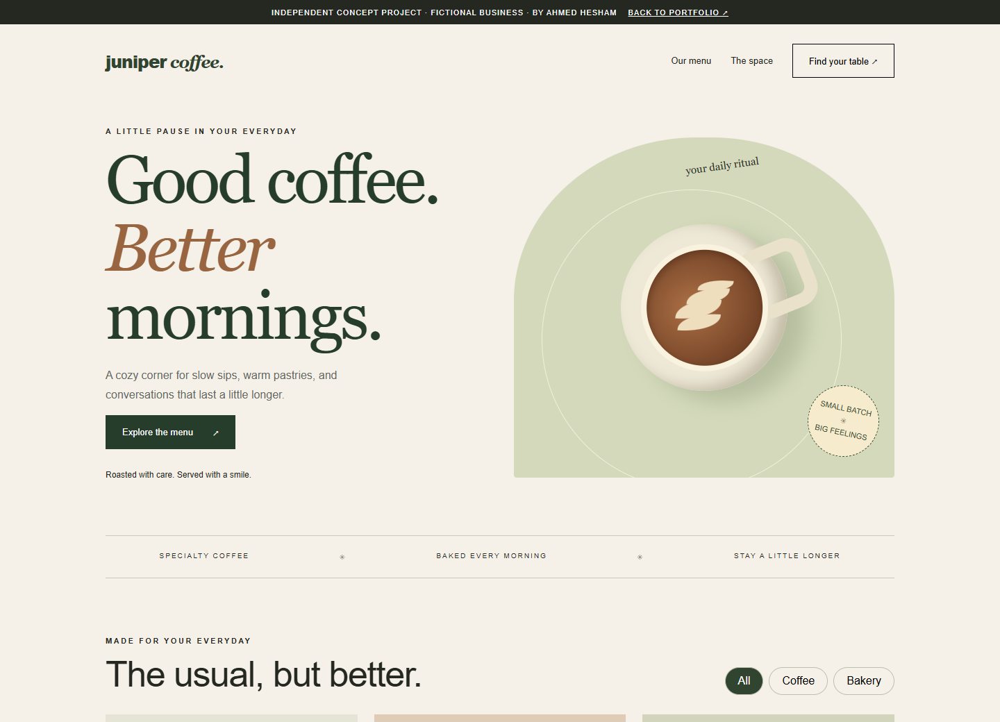

# Juniper Café

A responsive café website with menu filters and a booking-preview dialog.

A portfolio concept by Ahmed Hesham. All business information is fictional.

[Live demo](https://ahmedhesham.website/assets/demos/juniper.html) · [Portfolio](https://ahmedhesham.website)

## Run locally
Open index.html in a modern browser. HTML, CSS and JavaScript are self-contained; no installation or API keys are required.

## Features
- Responsive desktop and mobile layout
- Original CSS/SVG visual design
- Interactive controls and accessible dialogs

## Limitations
Front-end demonstration only. No backend, account system, real bookings, email delivery or payments. 
